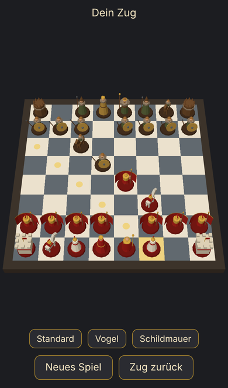

# Roman Chess

Schach im Browser: Du führst Rom (Weiß), der Computer die Germanen (Schwarz). 3D mit three.js, für Desktop und für Safari auf iPhone und iPad.

## Input und Output

```bash
npm install
npm run dev
```

`npm run dev` startet Vite, einen kleinen Entwicklungsserver. Er zeigt zwei Adressen: `Local:` für den Browser am Rechner, `Network:` für iPhone oder iPad im selben WLAN.



- Tippe eine römische Figur an. Felder, auf die sie darf, bekommen einen Punkt, Figuren, die sie schlagen kann, einen Ring.
- Tippe ein markiertes Feld: Die Figur gleitet hin, ein Springer springt im Bogen.
- Dann überlegen die Germanen kurz und ziehen. Beim Schlagen stößt der Angreifer zu, das Opfer kippt um und versinkt im Brett.
- Mit einem Finger wischen dreht die Kamera ums Brett, zwei Finger zoomen (am Rechner: ziehen und Mausrad). Ein kurzer Tipp wählt weiterhin nur Figuren aus.
- **Standard**, **Vogel** und **Schildmauer** fahren die Kamera sanft in drei feste Ansichten: schräg hinter Rom, von oben, tief von der Seite mit den Schilden schräg von vorne.
- Oben steht der Stand: dein Zug, Schach, Schachmatt oder Patt. Ganz unten: **Neues Spiel** und **Zug zurück** (nimmt deinen Zug samt Antwort zurück).

```bash
npm test
```

12 Tests mit Nodes eingebautem Test-Runner. Perft zählt alle Zugfolgen bis zu einer Tiefe: Die Startstellung muss 20, 400, 8902 ergeben, drei weitere Stellungen prüfen Rochade, en passant und Umwandlung. Dazu Einzeltests für Sonderregeln, Matt und Patt sowie drei Tests für den Computergegner.

`npm run build` prüft die Typen und legt die fertige Seite in `dist/`.

## Dateien, Zentrum zuerst

```text
src/
├── rules.ts          Zentrum: Schachregeln. Stellung rein, legale Züge, neue Stellung, Schach/Matt/Patt raus
├── main.ts           Spielablauf: Tipp → Zug → Animation → Zug des Computers; Leiste und Status
├── ai.ts             Computergegner: Minimax mit Alpha-Beta, 3 Halbzüge, danach Schlagfolgen zu Ende gerechnet
├── board.ts          three.js: Kamera (drehen, zoomen, drei Ansichten), Licht, Brett, Figuren, Markierungen, Tipp oder Wischen
├── animate.ts        Gleiten, Springerbogen, Angriff, Umkippen, Versinken
├── pieces/
│   ├── parts.ts      Farben, Grundformen, Sockel und die Abmachung, die jede Figur einhält
│   ├── pawn.ts       Bauer: Legionär mit Scutum und Speer / Krieger mit Rundschild
│   ├── rook.ts       Turm: steinerner Wachturm / Holzturm mit Pfählen
│   ├── knight.ts     Springer: Reiter
│   ├── bishop.ts     Läufer: Priester mit spitzer Kopfbedeckung
│   ├── queen.ts      Dame: Zackenkrone
│   └── king.ts       König: Reif und langer Stab, die höchste Figur
├── rules.test.ts     Perft und Sonderregeln
└── ai.test.ts        Matt in einem Zug, freie Dame schlagen, keine Dame für einen Bauern geben
index.html            Seite: Statuszeile, Brett, Leiste
package.json          npm-Befehle; Abhängigkeit: three, zum Entwickeln vite, typescript und Typen
tsconfig.json         Einstellungen für die Typprüfung
screenshot.png        das Bild oben
```

Ein Zug läuft so durch die Dateien:

```text
Tipp → board.onTap → main.tap → rules.legalMoves
     → animate.animateMove → rules.makeMove → board.show
     → ai.bestMove → derselbe Weg für den Zug des Computers
```

## Eine Figur durch ein glTF-Modell ersetzen

Jede Figur-Datei exportiert eine Funktion `(color) => THREE.Object3D`. Wer sie ersetzt, muss nur diese Funktion anders füllen. Beispiel für den Bauern:

1. Modelle nach `public/models/` legen, z. B. `legionaer.glb` und `germane.glb`. Vite liefert `public/` unter `/` aus.
2. Inhalt von `src/pieces/pawn.ts` ersetzen:

```ts
import * as THREE from 'three';
import { GLTFLoader } from 'three/addons/loaders/GLTFLoader.js';
import type { Color } from '../rules.ts';

const loader = new GLTFLoader();
const legionary = (await loader.loadAsync('/models/legionaer.glb')).scene;
const warrior = (await loader.loadAsync('/models/germane.glb')).scene;

export function pawn(color: Color): THREE.Object3D {
  return new THREE.Group().add((color === 'w' ? legionary : warrior).clone());
}
```

3. Das Modell muss die Abmachung aus `src/pieces/parts.ts` einhalten: steht auf y = 0, mittig, etwa ein Feld groß, schaut nach −z. Sonst am geladenen Modell korrigieren, z. B. `legionary.scale.setScalar(0.5)` oder `legionary.rotation.y = Math.PI` (viele glTF-Modelle schauen nach +z). Die äußere Gruppe dreht das Brett (Schwarz um 180°), die Korrekturen am Modell bleiben davon unberührt.

Ausprobiert mit dem eigenen Bauern, als `.glb` exportiert: Er lädt so im Entwicklungsserver und in `npm run build`.

## Was fehlt

- Nicht auf einem echten iPhone getestet, nur in Chromium mit iPhone-Bildschirmgröße.
- Umwandlung immer in eine Dame, ohne Auswahl.
- Remis durch 50-Züge-Regel, dreifache Wiederholung oder zu wenig Material; solche Partien laufen einfach weiter.
- Nur gegen den Computer, nicht zu zweit an einem Gerät.
- Der Computer ist schwach: keine Eröffnungen, kein Gefühl für Königssicherheit.
- Keine Töne, keine Schatten, keine Brettbeschriftung (a–h, 1–8).
- Germanen stehen je nach Feld leicht gedreht. Nach ihrem Zug springt die Drehung am Ende um ein paar Grad.
- Die Figuren sind einfache Formen; das Pferd ist am wenigsten gelungen.

## Entscheidungen in dieser Version

- **Regeln selbst geschrieben** statt chess.js (DECISIONS.md): keine Abhängigkeit, und die Suche des Computers braucht schnelle Züge. Perft bestätigt die Regeln.
- **Tests mit Node** (`node --test`) statt Vitest: Node 22 führt TypeScript direkt aus, eine Abhängigkeit weniger.
- **Gezeichnet wird nur bei Änderungen**, nicht 60-mal pro Sekunde. Schach steht meistens still; das schont Akku und Wärme.
- **Tippen oder Wischen** entscheidet sich beim Loslassen: weniger als 10 Pixel Bewegung ist ein Tipp, sonst hat die Kamera gedreht. Ein zweiter Finger macht nie einen Tipp daraus.
- **Kamera ohne Nachlauf** (OrbitControls ohne Dämpfung): Sie bewegt sich nur, solange der Finger zieht. So braucht es keine Dauerschleife, gezeichnet wird weiter nur bei Änderungen.
- **Der Computer rechnet im Hauptthread**, aber erst, wenn keine Animation läuft. Gemessen auf dem Server: Median 51 ms, langsamster Zug 0,5 s in einer Partie über 120 Halbzüge.

## Offene Fragen

1. **Unterwegs spielen?** Ohne laufenden Rechner geht es nicht. Soll die Seite veröffentlicht werden, z. B. über GitHub Pages?
2. **Zu zweit an einem Gerät** wieder einbauen, als Schalter in der Leiste?
3. **Umwandlung mit Auswahl** (Dame, Turm, Läufer, Springer) oder bei Dame bleiben?
4. **Stärke des Computers:** so lassen oder stärker machen (Rechnen im Hintergrund per Web Worker, tiefere Suche, Stufen)?
